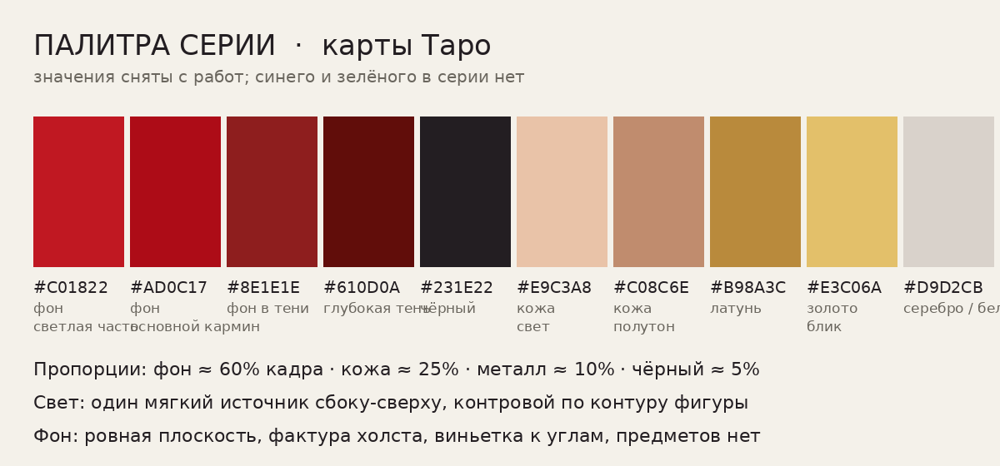
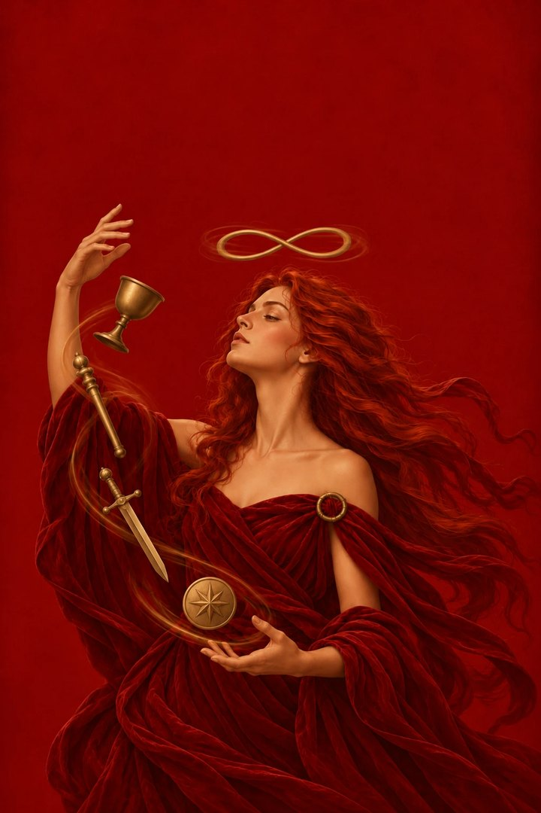
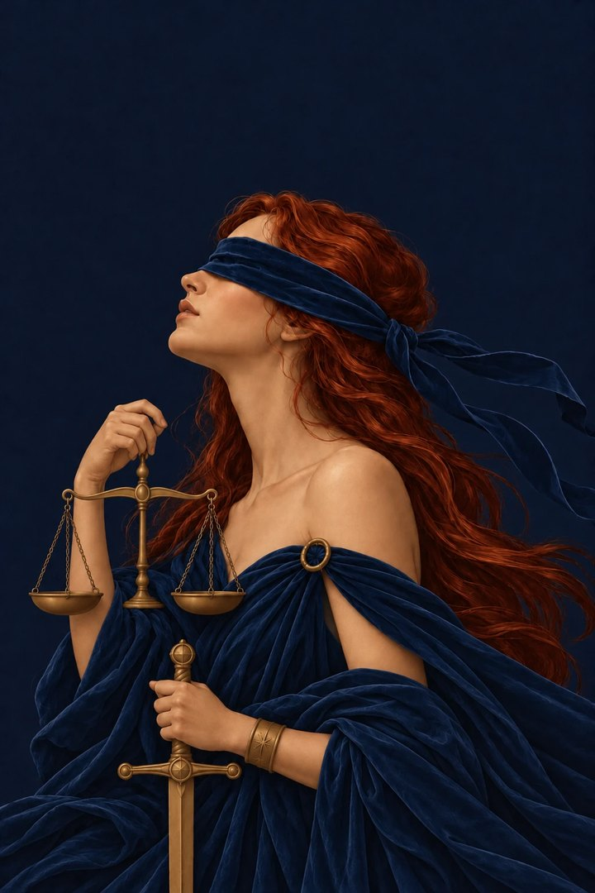
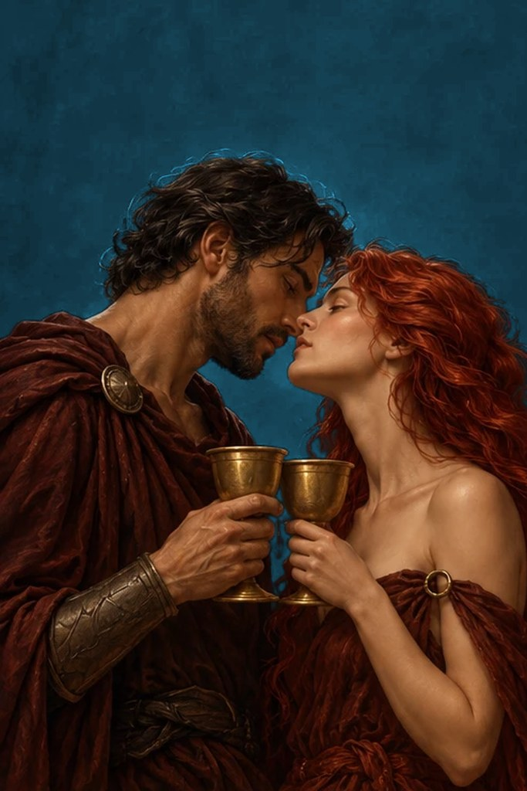
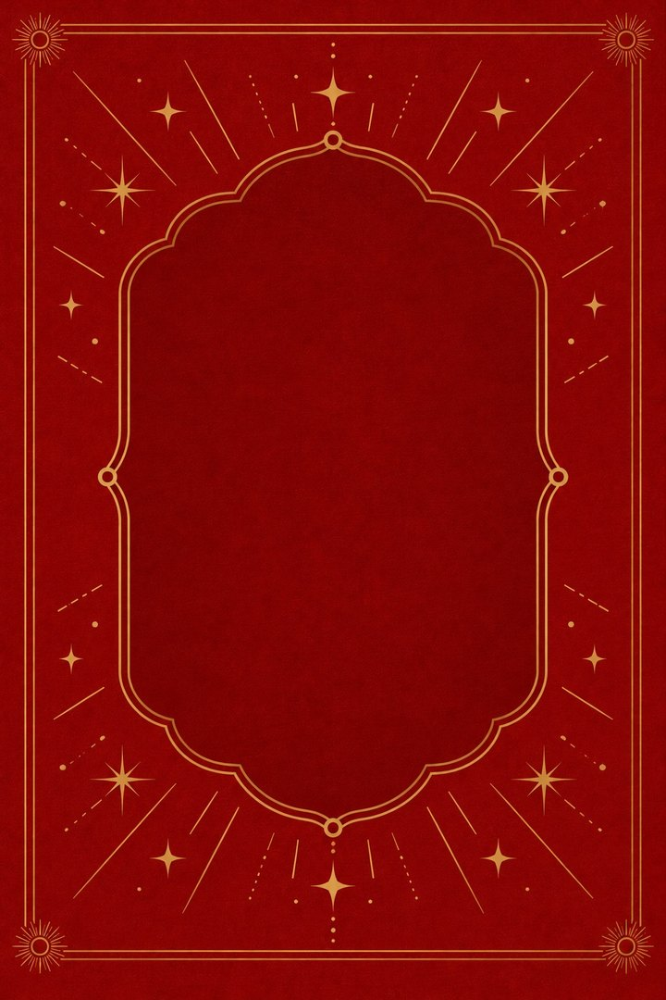
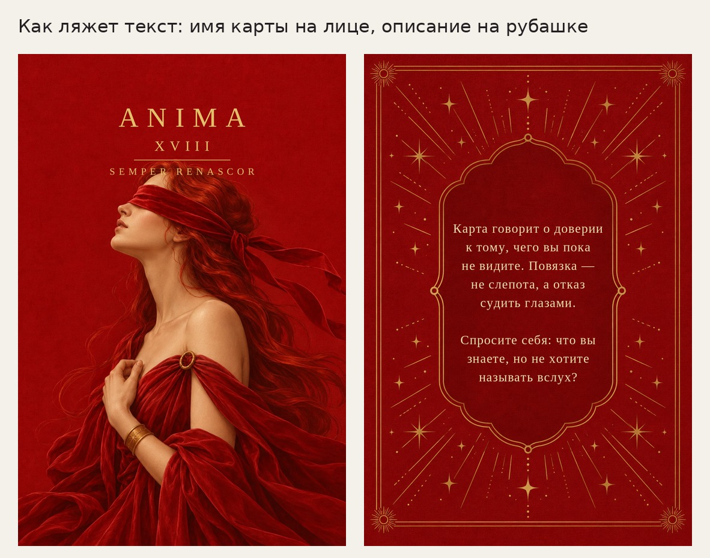

# Оформление карт колоды

Материал для генерации изображений карт: палитра, строй кадра и требования
к рубашке. Нужен, чтобы карты, нарисованные в разное время, выглядели одной
колодой.

## Палитра

| Цвет | Где |
| --- | --- |
| `#C01822` | фон, светлая часть |
| `#AD0C17` | фон, основной кармин |
| `#8E1E1E` | фон в тени |
| `#610D0A` | глубокая тень |
| `#231E22` | чёрный |
| `#E9C3A8` / `#C08C6E` | кожа: свет и полутон |
| `#B98A3C` / `#E3C06A` | латунь и блик золота |
| `#D9D2CB` | серебро, белила |

Синего и зелёного в колоде нет. Пропорции кадра: фон около 60%, кожа 25%,
металл 10%, чёрный 5%.

## Лицо карты

Вертикаль 2:3 (1024×1536). Одна фигура в центре и нижних двух третях, сверху
пустое поле под надпись. Фон — ровная красная плоскость с фактурой холста и
виньеткой, без интерьера и пейзажа. Свет один, мягкий, сбоку-сверху, с контровым
по контуру. Живопись гладкая, мазок почти не виден, контур не обведён.

Текст на изображении не генерируется: имя карты, римская цифра и девиз
накладываются отдельно серифными прописными с разрядкой, золотом по красному.

## Рубашка

Та же вертикаль. Орнамент строго симметричен при повороте на 180° — иначе
перевёрнутая карта выдаёт себя. В центре вертикальный картуш (примерно 55% высоты
и 60% ширины): ровное однотонное поле под описание карты, без узора и бликов.

Для моушн-дизайна рубашка нужна послойно, на прозрачном фоне и в одинаковых
координатах: рамка, лучи и звёзды, картуш, фон с фактурой. Из плоской картинки
анимировать нечего. Линии одной толщины, не больше трёх цветов: тонкие градиенты
разваливаются на полосы при сжатии видео в Telegram.

## Кто изображён

Колода женская: героиня одна и та же во всех старших арканах, кроме тех, где
мужское заложено в самой карте — Император, Иерофант, мужчина во Влюблённых.
Шут — юноша, ребёнок на Солнце — ребёнок, у Смерти под забралом нет никого.

В младших это правило сохраняется, но фигурные карты идут по своим ролям:

| Карта | Кто |
| --- | --- |
| Паж | юноша |
| Рыцарь | мужчина верхом |
| Королева | женщина, та же героиня |
| Король | мужчина |

Числовые карты, где фигура одна, пишутся с героиней; где фигур несколько —
как требует сюжет.

## Счёт предметов в младших

Числовая карта обязана показывать своё число, и зритель считает то, что видит, —
предмет, закрытый фигурой, не считается. Модель попадает в число, когда раскладку
задают арифметикой, и мажет, когда её описывают формой.

| Запрос | Вышло |
| --- | --- |
| «пять в нижнем ряду и три поверх» | восемь, верно |
| «семь в два яруса» | семь, верно |
| «четыре слева, четыре справа, один позади головы» | девять, верно |
| «пять слева и пять справа» | десять, верно |
| «ровной дугой» (девять) | восемь |
| «широкой пологой дугой» (десять) | семь |

Поэтому предметы раскладывают слагаемыми и повторяют сумму числом и словом, а про
края кадра пишут отдельно: на первой десятке крайний левый кубок срезало границей
ячейки.

Арифметика держится, пока слагаемые невелики. Девятка Мечей трижды пришла с восемью
мечами: и на «пять в верхнем ряду и четыре в нижнем», и на перечисление подряд от
первого до девятого — в последний раз безупречной ровной лесенкой, с точным шагом
в 56 пикселей по вертикали и 79 по горизонтали.

Перерисовывать такую карту незачем: девятый предмет на ней уже нарисован восемь раз.
`scripts/clone_pip.py` вырезает один вместе с куском фона и вклеивает копию со
сдвигом на шаг ряда, растворяя края заплатки. Работает это только на ровном фоне и
в регулярном ряду; скрипт проверяет, что на месте копии нет чужой живописи, но шаг
и правдоподобие ряда не проверяет, поэтому результат смотрят глазами. На девятке
последний шаг пришлось сократить с 79 до 55, иначе остриё упиралось в край кадра.

Придворные карты листом не берут, и дело не только в мягкости лиц. На листе Кубков
королева и король пришли без поля под надпись — головы начинались на 6% и 8% высоты,
— а `fit_title.py`, опустив их, протащил вверх по пряди волос: над обеими макушками
встали тёмные рожки. Замеры их не видят, поле числится чистым на 6.1, потому что
след тонкий и почти в цвет фона; виден он только глазом. Паж и рыцарь с того же
листа прошли, так что лист годится на придворные карты ровно наполовину.

Перерисованные поодиночке королева и король прошли приёмку как пришли, и лечит это
одна строка в запросе: «над макушкой остаётся широкая полоса пустого фона высотой
в треть кадра, и в ней нет ничего — ни волос, ни отдельных прядей, ни спинки трона».
Без неё фигура упирается головой в верхний край, а с ней поле под надпись выходит
чистым само, и `fit_title.py` не нужен.

Карты с большим счётом дешевле брать поодиночке, а не листом. Ячейка в листе
экономит три захода, но непрошедший лист перерисовывается целиком: девятка с
десяткой, не сойдясь в счёте, увели за собой весь третий лист Кубков, а поодиночке
обе вышли с первого раза и в полном размере.

## Группы и эталоны

Лицо карты красят по группе, рубашка одна алая на всю колоду.

| Группа | Карты | Фон |
| --- | --- | --- |
| Шут | 0 | `#B98D5B`, полированная бронза; подпись тёмно-коричневая `#4A2E18` |
| Первая семёрка | I–VII | кармин `#8F0303` |
| Вторая семёрка | VIII–XIV | ночной индиго `#101A33` |
| Третья семёрка | XV–XXI | угольный `#15120F` |
| Жезлы / Кубки / Мечи / Пентакли | младшие | `#6D1A01` / `#123A4A` / `#29232B` / `#2C3A1E` |

Цвет подписи задаётся вместе с фоном: на светлой карте золото не читается.

**Рубашка у каждой гаммы своя** и повторяет фон лицевой стороны. Рисовать восемь
рубашек заново не нужно: `scripts/make_backs.py` перекрашивает основу из слоёв
одной нарисованной, оставляя орнамент золотым. Слои приходят с куском красной
подложки вокруг линий, и она непрозрачная — скрипт отделяет орнамент по зелёному
каналу, у фона он почти нулевой.

    python scripts/make_backs.py ПАПКА_СО_СЛОЯМИ ПАПКА_РЕЗУЛЬТАТА

**Подпись занимает максимум две строки.** Имя из одного слова — цифра аркана
уходит на вторую строку; имя из двух слов — второе слово на второй строке, цифра
сразу за ним. Третьей строкой всегда краткое описание: одна строка, не длиннее
двух слов.
Каждой группе нужен свой принятый образец — внутри группы карты сверяются с ним,
а не с чужой гаммой.

Маг (I) — принятая карта первой семёрки, Правосудие (XI) — второй, двойка Кубков —
масти Кубков. Алое Правосудие (`reference/justice-face.jpg`) в колоду не идёт: его
заменил Маг.

**Эталон задаёт светлоту фона сильнее, чем названный в запросе цвет.** Первый лист
Кубков рисовался с приложенным Правосудием (`#101A33`, светлота 9.7) — и фон вышел
`#081C28` со светлотой 9.3 вместо заказанных `#123A4A` и 22.5, то есть повторил
эталон, а не запрос. Брать эталоном карту чужой группы можно только при совпадающей
светлоте: Жезлы рисовались с Магом (29.2 против своих 23.6) и разошлись всего на 13.

Даже с верным эталоном фон приходит темнее заказа, поэтому в запросе его просят
**на шаг светлее, чем просится**, и велят сличить углы с углами приложенной карты.
На Кубках это дало #0A303F и #0C3648 — расхождение с заказом 9.3 и 4.3, то есть
карта проходит приёмку прямо из генератора, без `cool_ground.py`.

Когда тон группы расходится с эталоном не светлотой, а оттенком, это пишут отдельной
строкой: Мечи рисовались с двойкой Кубков и требованием «от неё бери только светлоту,
а оттенок уведи из синевы в серо-фиолетовый» — и весь первый лист пришёл на #2B252F
при заказанных #2E2A38, то есть Δ5.3–8.3 без единой правки фона.

Тон Мечей потом пришлось привести к замеренному. Десять числовых карт и туз сели на
средний #29232B при разбросе 7 между собой, а лист придворных пришёл ещё темнее,
#221C22: от заказа это 16.0, от своей масти — 7.7, то есть не больше, чем карты
расходятся между собой. Чинить было нечем — `cool_ground.py` на Мечах не применим,
а `fix_ground.py` захватил 81–92% кадра и отказался, потому что бордовая ткань на
таком тёмном фоне одного с ним семейства. Тон масти теперь #29232B, и от него все
карты дают Δ1–9.6.

**Тон рубашки меряют по её фону, а не по углу карты.** У лица в углу чистый фон,
у рубашки там золотая рамка с солнцем, и замер по тому же квадрату завышает яркость
на 10–15 единиц. Померенные так, шесть рубашек из восьми выглядели разошедшимися со
своими лицами на 13–20 при допуске 12; померенные по фону — все восемь укладываются
в 2.3–9.3, Мечи с новым тоном в том числе. Фон берут по медиане тех пикселей, что
темнее полутора медиан яркости: орнамент занимает около шести процентов кадра и
ярче фона вдвое, так что порог отделяет его чисто.

Слои рубашек в репозиторий не попали, и `make_backs.py` без них не работает. Если
тон группы уточнится настолько, что рубашка выйдет из допуска, её перекрашивает
`scripts/retint_back.py`: он отделяет золото тем же порогом по яркости и красит
всё остальное, сохраняя фактуру и виньетку. На бронзовой рубашке Шута он откажется
— там золото и фон одной светлоты, и такую рубашку собирают только из слоёв.

`cool_ground.py` на Мечах не работает и не нужен: их фон холоднее фигуры всего на 4
по разнице синего и красного против 28 у Кубков, так что предохранитель скрипта
откажет — но чинить там нечего.

Две типовые поправки, на которые написаны скрипты, — перерисовывать из-за них карту
не нужно:

- `scripts/fix_ground.py` приводит фон к цвету группы, когда модель увела его в тень;
- `scripts/cool_ground.py` делает то же на холодных мастях (Кубки, Мечи), где
  `fix_ground.py` красит фигуру заодно с фоном;
- `scripts/fit_title.py` опускает фигуру, когда она залезла в поле под надпись: фон
  сверху растягивается, низ подрезается, и это не видно, потому что ткань там и так
  уходит за край.

На холодных мастях заливка от краёв не годится вовсе. Фон Кубков вышел почти чёрным,
и тёмные волосы, складки бархата и тени попали в её допуск: `fix_ground.py` покрасил
синим половину фигуры, заняв при этом 57% кадра — предохранитель на 75% промолчал, и
брак был виден только глазом. `cool_ground.py` отделяет фон по цветовому семейству:
фон холодный, фигура целиком тёплая, и разница синего и красного каналов разводит их
начисто (на первом листе Кубков фон дал +28, фигура от -31 до -56).

Фон карты и ткань на фигуре обязаны различаться по светлоте. У первой попытки Мага
бархат был написан ровно в цвет фона: силуэт тонул, а `scripts/fix_ground.py` отказался
её чинить — границы между фигурой и фоном попросту не было.

| Замер | Значение |
| --- | --- |
| Фон лица (вторая семёрка) | `#0D162A` при заказанном `#101A33` |
| Фон рубашки | `#8C0C07` |
| Расхождение фонов | 5.3 из 255 |
| Разброс в зоне заголовка (10–20% высоты) | 1.3 |
| Фигура начинается на | 22% высоты |
| Поле под текст на рубашке | 57% × 45% карты (x 21.5–78.5%, y 26–71%) |
| Знаков в поле при 15 px | около 234; нужно до 210 |
| Контраст золота на обеих сторонах | 10.3 : 1 и 6.2 : 1 |
| Симметрия рубашки при повороте 180° | расхождение 8.8 из 255 |
| Доля латуни в кадре | 10.3% |

Рубашка собирается из четырёх слоёв (рамка, лучи, картуш, фон с фактурой) —
они складываются в неё без расхождений, и анимация работает именно со слоями.

## Эталон колоды

Первая принятая карта (лицо) и рубашка задают числа, по которым проверяются все
следующие. Замеры делаются по готовому изображению:

| Параметр | Значение | Допуск |
| --- | --- | --- |
| Фон лица | `#960606` | расхождение с фоном рубашки меньше 12 из 255 |
| Разброс яркости в верхнем поле | 6.6 | меньше 12, иначе надпись тонет |
| Пустое поле сверху | 24% высоты | 20–25% |
| Заголовочный блок | выше 330 px при высоте 1536 | ниже начинается фигура |
| Контраст золота `#E3C06A` на фоне | 5.2 : 1 | от 4.5 |
| Контраст текста в картуше рубашки | 6.7 : 1 | от 4.5 |

Имя карты и римская цифра держатся сами; латинский девиз на лице необязателен —
он первым начинает задевать волосы.

## Единство колоды

Первая удачная карта становится референсом для всех следующих: её прикладывают
к запросу со словами «та же колода, та же палитра и свет, другой сюжет».
Без этого карты расходятся по тону уже к третьей.
